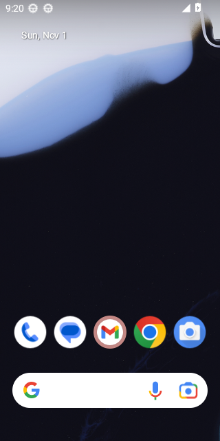
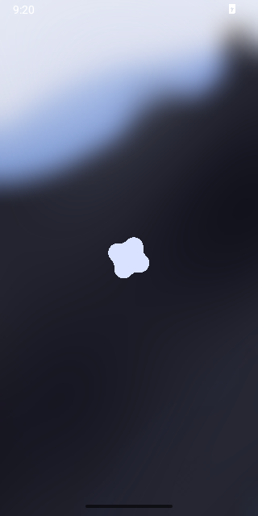

# Android-Security-Lab

<!-- ANDROID_READINESS_RESULTS_START -->
## Результаты последней проверки эмуляторов

Обновлено: **2026-11-01 21:20 UTC**. [Открыть запуск GitHub Actions](https://github.com/mkkazakova/Android-Security-Lab/actions/runs/41351349897).

| Параметр | Android 13 (API 33) | Android 16 (API 36) |
|---|---|---|
| Состояние инфраструктурного теста | PASS | PASS |
| Фактическая версия Android | 13 | 16 |
| Фактический API | 33 | 36 |
| SELinux (наблюдаемое состояние) | Enforcing | Enforcing |
| Шифрование (состояние эмулятора) | encrypted | encrypted |
| Тип шифрования (эмулятор) | file | file |
| Verified Boot (свойство эмулятора) | — | — |
| Загрузка Android завершена | PASS | PASS |
| Версия API соответствует ожидаемой | PASS | PASS |
| Получен настоящий PNG | PASS | PASS |

### Скриншоты виртуальных устройств

| Android 13 | Android 16 |
|---|---|
|  |  |

> Примечание: это проверка запуска **эмулятора**, а не испытания изоляции приложений, IPC, Keystore или аппаратного Verified Boot. Значения системных свойств не доказывают эффективность защиты на физическом смартфоне. Подробные журналы и JSON доступны в Artifacts соответствующего запуска.

<!-- ANDROID_READINESS_RESULTS_END -->

<!-- ANDROID_STAGE1_START -->
## Эксперименты: изоляция приложений и IPC

Данные получены при автоматизированном запуске двух обычных приложений в Android Emulator.
Обновлено: 2026-11-01 22:24 UTC.
[Открыть запуск GitHub Actions](https://github.com/mkkazakova/Android-Security-Lab/actions/runs/41356826442).

| Сценарий | Android 13 (API 33) | Android 16 (API 36) |
|---|---|---|
| **S1** — Owner читает собственный приватный файл | НЕТ ОТЧЁТА | НЕТ ОТЧЁТА |
| **S2** — Client пытается напрямую читать приватный файл Owner | НЕТ ОТЧЁТА | НЕТ ОТЧЁТА |
| **S3** — Client обращается к закрытому ContentProvider | НЕТ ОТЧЁТА | НЕТ ОТЧЁТА |
| **S4** — Client обращается к открытому ContentProvider | НЕТ ОТЧЁТА | НЕТ ОТЧЁТА |
| **S5** — Client обращается к Provider с signature-разрешением | НЕТ ОТЧЁТА | НЕТ ОТЧЁТА |

**Итог:** Android 13 — NO REPORT; Android 16 — NO REPORT.

### Фактические скриншоты приложений

| Android 13 | Android 16 |
|---|---|
| Нет изображения | Нет изображения |
| Нет изображения | Нет изображения |

> Это результаты испытаний **виртуальных устройств**, а не физического смартфона. Проверка S2 подтверждается только при наличии исходного файла у Owner; проверка S4 используется как положительный контроль для IPC.

Подробные JSON-отчёты, журналы и изображения доступны в разделе Artifacts указанного запуска.

<!-- ANDROID_STAGE1_END -->

<!-- RESEARCH_DOCS_LINKS_START -->
## Документация курсовой работы

- [План курсовой](docs/project-plan.md)
- [Архитектура испытательного стенда](docs/architecture.md)
- [Методика: 14 экспериментов](experiments/test-plan.md)
- [Проект официального задания](docs/course-assignment.md)

<!-- RESEARCH_DOCS_LINKS_END -->
