# Android-Security-Lab

<!-- ASL_VISUAL_INTRO_START -->
## Приложения и подтверждающие изображения

**SecurityOwner** и **SecurityClient** — два обычных Android-приложения (APK), установленные в Android Emulator. Они имеют разные UID; операции выполняются через стандартные Android API. Экраны показывают наблюдения приложений, а системные окна — отдельно, когда Android действительно их предоставляет.

<!-- ASL_VISUAL_GALLERY_START -->
| Наблюдение | Android 13 | Android 16 |
|---|---|---|
| Установленные приложения в системном меню | 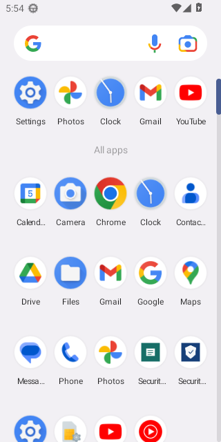 | 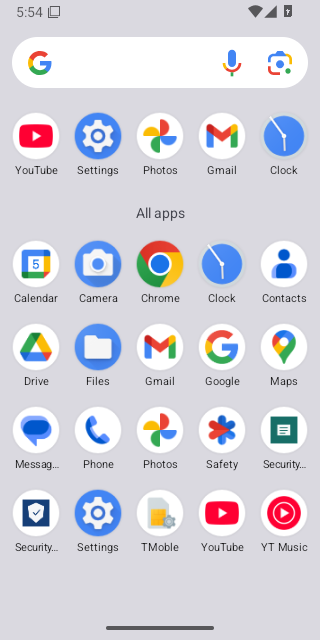 |
| Системный запрос доступа к CAMERA | 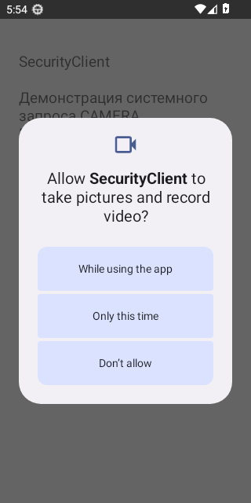 | 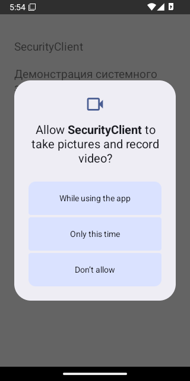 |
| P1: разрешение CAMERA отсутствует |  | 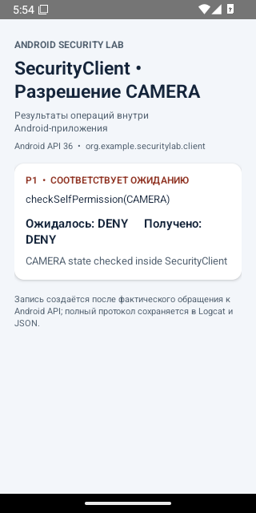 |
| P2: разрешение CAMERA предоставлено | 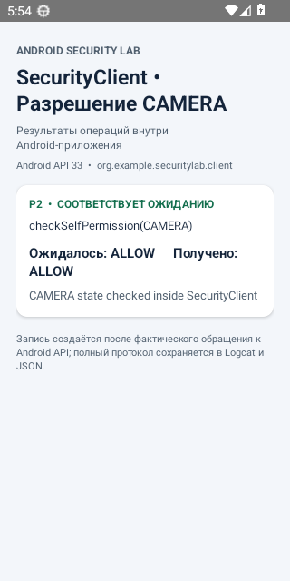 | 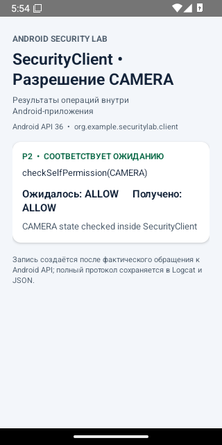 |
| P3: разрешение CAMERA отозвано | 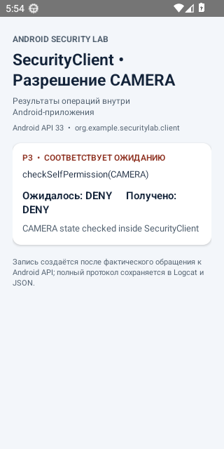 | 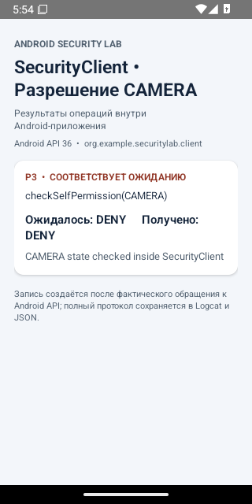 |
| F1: чтение собственного файла | 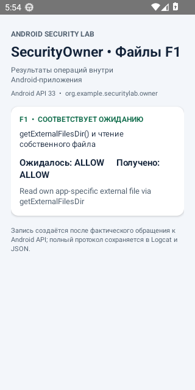 | 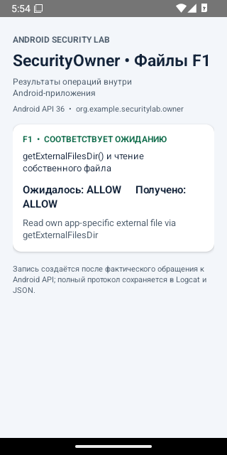 |
| F2: запрет чтения чужого файла | 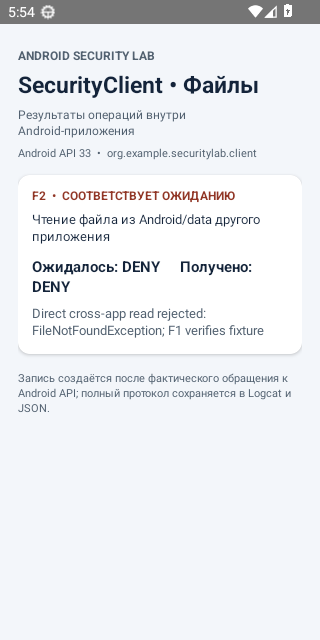 | 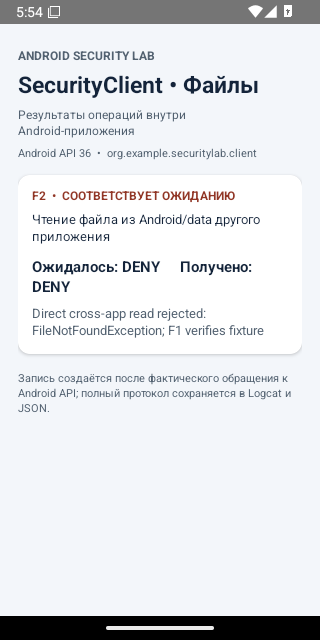 |
| K1: шифрование и расшифрование | 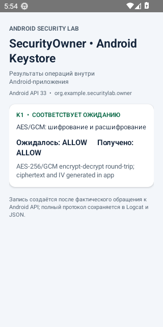 | 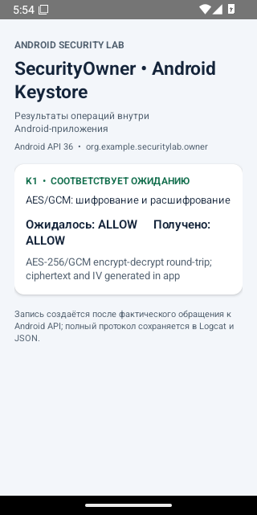 |
| K2: отказ в экспорте ключа | 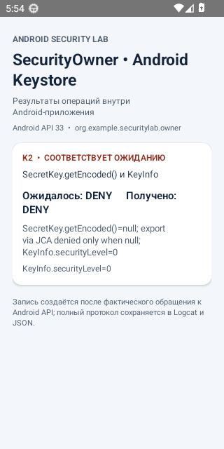 | 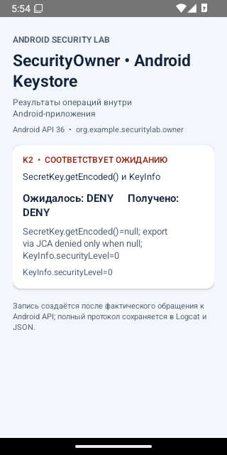 |
| K3: межприложенная изоляция ключа | 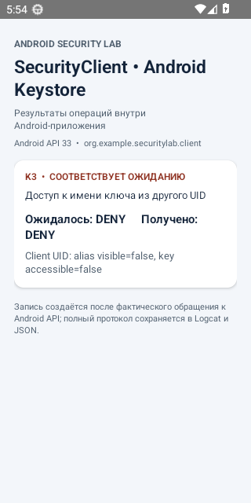 | 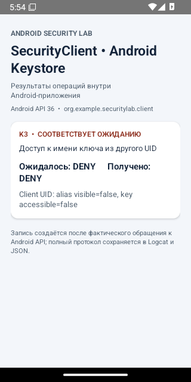 |

S1 и S2–S5: реальные результаты операций показаны на экранах Owner/Client ниже; ошибки Android дополнительно подтверждаются `detail` в JSON и Logcat. F3: подлинный системный выбор документа показан в разделе файловых испытаний.

Для отказов в доступе Android не всегда показывает системное окно: приложение получает исключение или ответ API. Диагностические экраны отображают именно эти ответы, а не системные уведомления.
<!-- ASL_VISUAL_GALLERY_END -->
<!-- ASL_VISUAL_INTRO_END -->

<!-- ASL_GUIDE_START -->
## Что находится в репозитории

Здесь приведены **инструкции и фактические результаты** 14 проверок встроенных механизмов безопасности Android. 

Для испытаний используются два независимых приложения — **SecurityOwner** (создаёт тестовые ресурсы) и **SecurityClient** (проверяет доступ к ним). Приложения не выполняют атаки с root-доступом. Все данные синтетические.

### Условия проведения

| Параметр | Значение |
|---|---|
| Операционная система | Android 13 и Android 16 |
| API Level | 33 и 36 соответственно |
| `targetSdk` обоих приложений | 33 |
| Испытательная среда | Android Emulator, два приложения с разными UID |
| Инструменты | ADB, скрипты в `scripts/`, GitHub Actions |
| Зафиксированный успешный прогон | [5 ноября 2026 года](https://github.com/mkkazakova/Android-Security-Lab/actions/runs/42021014242) |
| Машиночитаемые данные | [`results/latest-api-33.json`](results/latest-api-33.json), [`results/latest-api-36.json`](results/latest-api-36.json), [`results/summary.json`](results/summary.json) |

Сравнивается поведение **одних и тех же приложений с targetSdk 33** в двух версиях Android. Эти результаты не позволяют оценить все возможные конфигурации Android или аппаратные свойства конкретного смартфона.

### Как повторить испытания

1. Перейти в репозитории в **Actions → Android Security Lab - Complete Experiments**.
2. Выбрать ветку `master` и нажать **Run workflow**.
3. Дождаться выполнения проверок API 33 и API 36, затем задания публикации результатов.
4. Проверить `results/latest-api-33.json`, `results/latest-api-36.json` и `results/summary.json`. У каждого сценария должны присутствовать `expected`, `observed` и `pass`.
5. При необходимости получить полные журналы и дополнительные изображения из **Artifacts** соответствующего запуска GitHub Actions.

Основной сценарий запуска — `scripts/run-tests.sh`. Скрипты `run-stage1.sh`–`run-stage4.sh` и отдельные Python-модули выполняют последовательные группы проверок. Реальные операции с ресурсами выполняются внутри Android-приложений.

**Интерпретация:** `PASS` означает совпадение наблюдения с ожидаемым поведением. `DENY` при тестировании запрета доступа является успешным результатом. Ошибка автоматизации (`ERROR`) сама по себе не подтверждает механизм защиты.

## Проведённые эксперименты

### Изоляция приложений и IPC — S1–S5

#### S1. Чтение собственного приватного файла
**Что проверяли:** изоляция приложений.
**Порядок действий:** Создать приватный файл средствами SecurityOwner и прочитать его от имени этого же приложения.
**Ожидаемый результат:** `ALLOW`.
**Наблюдение:** Приложение-владелец успешно считывает записанные тестовые данные.
**Итог:** Android 13 — **PASS (ALLOW)**; Android 16 — **PASS (ALLOW)**.
**Подтверждение:** запись `S1` в JSON-отчётах [API 33](results/latest-api-33.json) и [API 36](results/latest-api-36.json).

#### S2. Попытка чтения чужого приватного файла
**Что проверяли:** изоляция приложений.
**Порядок действий:** Сохранить приватный файл в SecurityOwner; из SecurityClient с другим UID попытаться открыть его по прямому пути. Отдельно убедиться, что файл действительно существует.
**Ожидаемый результат:** `DENY`.
**Наблюдение:** Android отклоняет прямой доступ. Зарегистрировано FileNotFoundException, наличие файла подтверждено проверкой исходных данных.
**Итог:** Android 13 — **PASS (DENY)**; Android 16 — **PASS (DENY)**.
**Подтверждение:** запись `S2` в JSON-отчётах [API 33](results/latest-api-33.json) и [API 36](results/latest-api-36.json).

#### S3. Доступ к закрытому ContentProvider
**Что проверяли:** межприложенное взаимодействие.
**Порядок действий:** SecurityClient выполняет запрос к ContentProvider SecurityOwner, который закрыт для других приложений.
**Ожидаемый результат:** `DENY`.
**Наблюдение:** Запрос отклоняется системой с SecurityException.
**Итог:** Android 13 — **PASS (DENY)**; Android 16 — **PASS (DENY)**.
**Подтверждение:** запись `S3` в JSON-отчётах [API 33](results/latest-api-33.json) и [API 36](results/latest-api-36.json).

#### S4. Доступ к открытому ContentProvider
**Что проверяли:** межприложенное взаимодействие.
**Порядок действий:** SecurityClient обращается к намеренно открытому тестовому ContentProvider приложения SecurityOwner.
**Ожидаемый результат:** `ALLOW`.
**Наблюдение:** Запрос разрешён, возвращено ожидаемое тестовое содержимое.
**Итог:** Android 13 — **PASS (ALLOW)**; Android 16 — **PASS (ALLOW)**.
**Подтверждение:** запись `S4` в JSON-отчётах [API 33](results/latest-api-33.json) и [API 36](results/latest-api-36.json).

#### S5. ContentProvider с проверкой разрешения
**Что проверяли:** межприложенное взаимодействие.
**Порядок действий:** SecurityClient запрашивает данные ContentProvider, для которого установлено ограничение по разрешению, отсутствующему у клиента.
**Ожидаемый результат:** `DENY`.
**Наблюдение:** Система отклоняет запрос с SecurityException.
**Итог:** Android 13 — **PASS (DENY)**; Android 16 — **PASS (DENY)**.
**Подтверждение:** запись `S5` в JSON-отчётах [API 33](results/latest-api-33.json) и [API 36](results/latest-api-36.json).

**Скриншоты приложений при испытаниях Sandbox и IPC:**
| Материал | Android 13 | Android 16 |
|---|---|---|
| SecurityOwner | 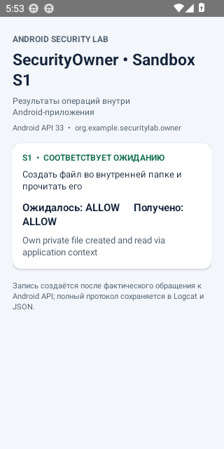 | 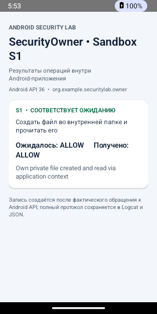 |
| SecurityClient | 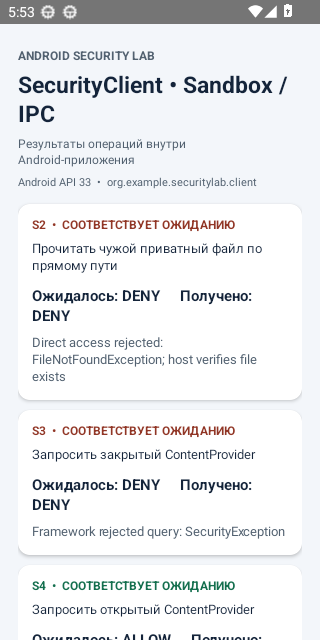 | 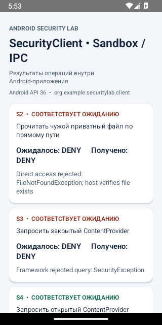 |

*Эти изображения показывают тестовые приложения. Доказательство разрешения или запрета доступа — результаты операций в JSON и журналах.*

### Управление разрешениями — P1–P3

#### P1. Камера: разрешение не выдано
**Что проверяли:** runtime permissions.
**Порядок действий:** Через ADB отозвать разрешение CAMERA, затем запустить PermissionProbeActivity в SecurityClient и вызвать checkSelfPermission.
**Ожидаемый результат:** `DENY`.
**Наблюдение:** Приложение видит отсутствие разрешения CAMERA.
**Итог:** Android 13 — **PASS (DENY)**; Android 16 — **PASS (DENY)**.
**Подтверждение:** запись `P1` в JSON-отчётах [API 33](results/latest-api-33.json) и [API 36](results/latest-api-36.json).

#### P2. Камера: разрешение выдано
**Что проверяли:** runtime permissions.
**Порядок действий:** Через ADB предоставить CAMERA тому же приложению и повторно проверить состояние через checkSelfPermission.
**Ожидаемый результат:** `ALLOW`.
**Наблюдение:** Приложение фиксирует наличие разрешения CAMERA.
**Итог:** Android 13 — **PASS (ALLOW)**; Android 16 — **PASS (ALLOW)**.
**Подтверждение:** запись `P2` в JSON-отчётах [API 33](results/latest-api-33.json) и [API 36](results/latest-api-36.json).

#### P3. Камера: разрешение отозвано
**Что проверяли:** runtime permissions.
**Порядок действий:** После P2 отозвать CAMERA через ADB, заново запустить Activity и проверить разрешение.
**Ожидаемый результат:** `DENY`.
**Наблюдение:** Приложение фиксирует отсутствие ранее предоставленного разрешения.
**Итог:** Android 13 — **PASS (DENY)**; Android 16 — **PASS (DENY)**.
**Подтверждение:** запись `P3` в JSON-отчётах [API 33](results/latest-api-33.json) и [API 36](results/latest-api-36.json).

*Разрешение выдаётся и отзывается ADB только для подготовки теста. Фактическое состояние проверяется приложением; работа физической камеры не испытывается.*

### Доступ к файлам — F1–F3

#### F1. Чтение собственного файла во внешнем хранилище
**Что проверяли:** scoped storage.
**Порядок действий:** Создать файл в собственной app-specific директории внешнего хранилища с помощью getExternalFilesDir и прочитать его тем же приложением.
**Ожидаемый результат:** `ALLOW`.
**Наблюдение:** Чтение собственных данных разрешено.
**Итог:** Android 13 — **PASS (ALLOW)**; Android 16 — **PASS (ALLOW)**.
**Подтверждение:** запись `F1` в JSON-отчётах [API 33](results/latest-api-33.json) и [API 36](results/latest-api-36.json).

#### F2. Прямой доступ к файлу другого приложения
**Что проверяли:** scoped storage.
**Порядок действий:** SecurityClient пытается напрямую открыть app-specific файл SecurityOwner. Убедиться, что тестовый файл создан и доступен владельцу.
**Ожидаемый результат:** `DENY`.
**Наблюдение:** Прямой доступ отклонён; в журнале зарегистрировано FileNotFoundException.
**Итог:** Android 13 — **PASS (DENY)**; Android 16 — **PASS (DENY)**.
**Подтверждение:** запись `F2` в JSON-отчётах [API 33](results/latest-api-33.json) и [API 36](results/latest-api-36.json).

#### F3. Чтение документа через системный выбор файла
**Что проверяли:** scoped storage и storage access framework.
**Порядок действий:** Разместить тестовый документ в Downloads, вызвать из SecurityClient ACTION_OPEN_DOCUMENT, выбрать документ через системный интерфейс и прочитать возвращённый URI через ContentResolver.
**Ожидаемый результат:** `ALLOW`.
**Наблюдение:** После выбора документа приложение получает URI и успешно читает содержимое.
**Итог:** Android 13 — **PASS (ALLOW)**; Android 16 — **PASS (ALLOW)**.
**Подтверждение:** запись `F3` в JSON-отчётах [API 33](results/latest-api-33.json) и [API 36](results/latest-api-36.json).

**Скриншоты из испытаний файлового доступа:**
| Материал | Android 13 | Android 16 |
|---|---|---|
| SecurityOwner | 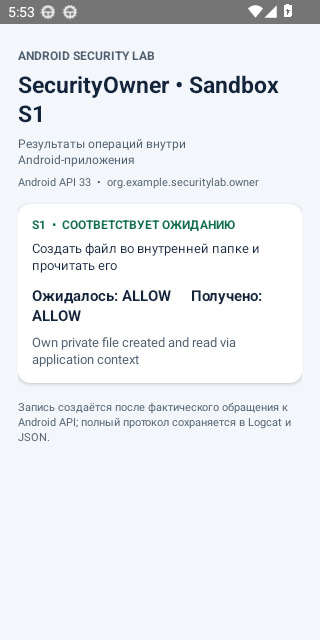 |  |
| SecurityClient | 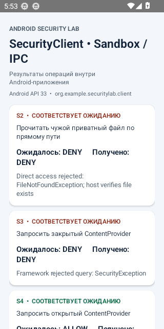 | 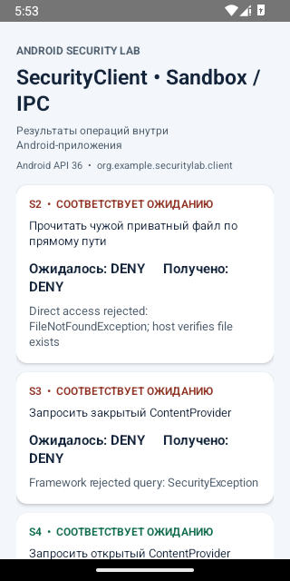 |
| Системный выбор документа F3 | 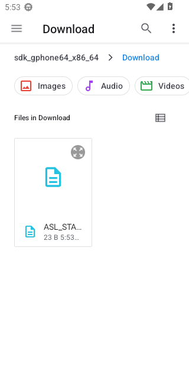 | 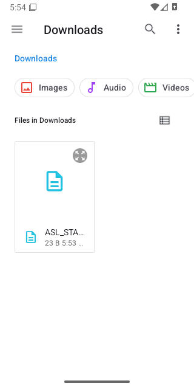 |

*F3 фиксирует работу системного выбора документа и доступ после выдачи URI, а не обход защиты файлового хранилища.*

### Android Keystore — K1–K3

#### K1. Шифрование и расшифрование с Android Keystore
**Что проверяли:** android keystore.
**Порядок действий:** Создать ключ AES-256 в Android Keystore, зашифровать тестовую строку в режиме GCM, затем расшифровать и сравнить исходные байты.
**Ожидаемый результат:** `ALLOW`.
**Наблюдение:** Шифрование и последующее расшифрование выполнены успешно; получены шифртекст и IV.
**Итог:** Android 13 — **PASS (ALLOW)**; Android 16 — **PASS (ALLOW)**.
**Подтверждение:** запись `K1` в JSON-отчётах [API 33](results/latest-api-33.json) и [API 36](results/latest-api-36.json).

#### K2. Попытка извлечения секретного ключа
**Что проверяли:** android keystore.
**Порядок действий:** Для созданного ключа вызвать SecretKey.getEncoded() и проверить KeyInfo.securityLevel.
**Ожидаемый результат:** `DENY`.
**Наблюдение:** getEncoded() возвращает null; экспорт ключа через этот API недоступен. В эмуляторе securityLevel=0 (программная защита).
**Итог:** Android 13 — **PASS (DENY)**; Android 16 — **PASS (DENY)**.
**Подтверждение:** запись `K2` в JSON-отчётах [API 33](results/latest-api-33.json) и [API 36](results/latest-api-36.json).

#### K3. Межприложенная изоляция ключа
**Что проверяли:** android keystore.
**Порядок действий:** В SecurityClient попробовать найти и использовать псевдоним ключа, созданного SecurityOwner; отдельно проверить доступ со стороны владельца.
**Ожидаемый результат:** `DENY`.
**Наблюдение:** Ключ недоступен клиенту, но доступен владельцу (положительный контроль).
**Итог:** Android 13 — **PASS (DENY)**; Android 16 — **PASS (DENY)**.
**Подтверждение:** запись `K3` в JSON-отчётах [API 33](results/latest-api-33.json) и [API 36](results/latest-api-36.json).

*Ограничение K1–K3:* `KeyInfo.securityLevel=0` в обоих эмуляторах означает программный уровень защиты. Аппаратные TEE и StrongBox в этих испытаниях не проверялись.

## Сравнение результатов

В обоих эмуляторах все **14 сценариев завершились успешно** (всего **28 PASS**). В пределах этих конкретных сценариев различий между Android 13 и Android 16 не обнаружено. Это не означает отсутствия изменений в безопасности между версиями Android в целом.

Сводная таблица ниже обновляется при каждом успешном запуске испытаний. Она содержит результаты последнего подтверждённого прогона и ссылку на GitHub Actions.

<!-- ASL_GUIDE_END -->

<!-- ANDROID_READINESS_RESULTS_START -->
## Результаты последней проверки эмуляторов

Обновлено: **2026-11-01 21:20 UTC**. [Открыть запуск GitHub Actions](https://github.com/mkkazakova/Android-Security-Lab/actions/runs/41351349897).

| Параметр | Android 13 (API 33) | Android 16 (API 36) |
|---|---|---|
| Состояние инфраструктурного теста | PASS | PASS |
| Фактическая версия Android | 13 | 16 |
| Фактический API | 33 | 36 |
| SELinux (наблюдаемое состояние) | Enforcing | Enforcing |
| Шифрование (состояние эмулятора) | encrypted | encrypted |
| Тип шифрования (эмулятор) | file | file |
| Verified Boot (свойство эмулятора) | — | — |
| Загрузка Android завершена | PASS | PASS |
| Версия API соответствует ожидаемой | PASS | PASS |
| Получен настоящий PNG | PASS | PASS |

### Скриншоты виртуальных устройств

| Android 13 | Android 16 |
|---|---|
|  |  |

> Примечание: это проверка запуска **эмулятора**, а не испытания изоляции приложений, IPC, Keystore или аппаратного Verified Boot. Значения системных свойств не доказывают эффективность защиты на физическом смартфоне. Подробные журналы и JSON доступны в Artifacts соответствующего запуска.

<!-- ANDROID_READINESS_RESULTS_END -->

<!-- ANDROID_STAGE1_START -->
## Экспериментальные результаты Android Security Lab

Обновлено: **2026-11-05 17:55 UTC**. [Запуск GitHub Actions](https://github.com/mkkazakova/Android-Security-Lab/actions/runs/42078468458).

| Проверка | Android 13 (API 33) | Android 16 (API 36) |
|---|---|---|
| **S1** — Владелец читает собственный приватный файл | PASS (ALLOW) | PASS (ALLOW) |
| **S2** — Другой UID не читает приватный файл | PASS (DENY) | PASS (DENY) |
| **S3** — Закрытый ContentProvider отклоняет запрос | PASS (DENY) | PASS (DENY) |
| **S4** — Открытый ContentProvider предоставляет данные | PASS (ALLOW) | PASS (ALLOW) |
| **S5** — ContentProvider защищён разрешением | PASS (DENY) | PASS (DENY) |
| **P1** — CAMERA: разрешение отсутствует | PASS (DENY) | PASS (DENY) |
| **P2** — CAMERA: разрешение выдано | PASS (ALLOW) | PASS (ALLOW) |
| **P3** — CAMERA: разрешение отозвано | PASS (DENY) | PASS (DENY) |
| **F1** — Владелец читает свой app-specific внешний файл | PASS (ALLOW) | PASS (ALLOW) |
| **F2** — Другому приложению запрещён прямой доступ к app-specific файлу | PASS (DENY) | PASS (DENY) |
| **F3** — Доступ к документу через системный выбор файла | PASS (ALLOW) | PASS (ALLOW) |
| **K1** — Android Keystore: шифрование и расшифрование AES-GCM | PASS (ALLOW) | PASS (ALLOW) |
| **K2** — Android Keystore: отказ в экспорте байтов секретного ключа | PASS (DENY) | PASS (DENY) |
| **K3** — Android Keystore: изоляция ключа между приложениями | PASS (DENY) | PASS (DENY) |

**Сводный статус:** Android 13 — PASS; Android 16 — PASS.

### Наблюдения и интерпретация

| Сценарий | Android 13: наблюдение | Android 16: наблюдение |
|---|---|---|
| S1 | Own private file created and read via application context | Own private file created and read via application context |
| S2 | Direct access rejected: FileNotFoundException; host verifies file exists | Direct access rejected: FileNotFoundException; host verifies file exists |
| S3 | Framework rejected query: SecurityException | Framework rejected query: SecurityException |
| S4 | Expected test data returned from provider | Expected test data returned from provider |
| S5 | Framework rejected query: SecurityException | Framework rejected query: SecurityException |
| P1 | CAMERA state checked inside SecurityClient | CAMERA state checked inside SecurityClient |
| P2 | CAMERA state checked inside SecurityClient | CAMERA state checked inside SecurityClient |
| P3 | CAMERA state checked inside SecurityClient | CAMERA state checked inside SecurityClient |
| F1 | Read own app-specific external file via getExternalFilesDir | Read own app-specific external file via getExternalFilesDir |
| F2 | Direct cross-app read rejected: FileNotFoundException; F1 verifies fixture | Direct cross-app read rejected: FileNotFoundException; F1 verifies fixture |
| F3 | System picker provided URI; ContentResolver read selected document | System picker provided URI; ContentResolver read selected document |
| K1 | AES-256/GCM encrypt-decrypt round-trip; ciphertext and IV generated in app | AES-256/GCM encrypt-decrypt round-trip; ciphertext and IV generated in app |
| K2 | SecretKey.getEncoded()=null; export via JCA denied only when null; KeyInfo.securityLevel=0 | SecretKey.getEncoded()=null; export via JCA denied only when null; KeyInfo.securityLevel=0 |
| K3 | Client UID: alias visible=false, key accessible=false; owner alias remains accessible (positive control) | Client UID: alias visible=false, key accessible=false; owner alias remains accessible (positive control) |

### Скриншоты из Android Emulator

| Материал | Android 13 | Android 16 |
|---|---|---|
| SecurityOwner |  |  |
| SecurityClient |  |  |
| Системный выбор документа F3 |  |  |

> PASS означает совпадение наблюдаемого поведения с гипотезой, в том числе при отказе в доступе. 
> Инфраструктурная ошибка не считается подтверждением механизма безопасности. 
> Тесты выполняются в эмуляторах, без выводов об аппаратной защите физического смартфона.

Подробные машинно-читаемые данные находятся в [`results/`](results/), а журналы и дополнительные файлы — в Artifacts запуска.

<!-- ANDROID_STAGE1_END -->

<!-- RESEARCH_DOCS_LINKS_START -->
## Файлы и дополнительные инструкции

- [Подробная методика всех 14 проверок](experiments/test-plan.md)
- [Устройство приложений и системы запуска](docs/architecture.md)
- [Методика работы с разрешениями](experiments/permissions.md)
- [Методика проверки файлового доступа](experiments/storage.md)
- [Методика Android Keystore](experiments/keystore.md)
- [Результаты в JSON](results/)

<!-- RESEARCH_DOCS_LINKS_END -->
